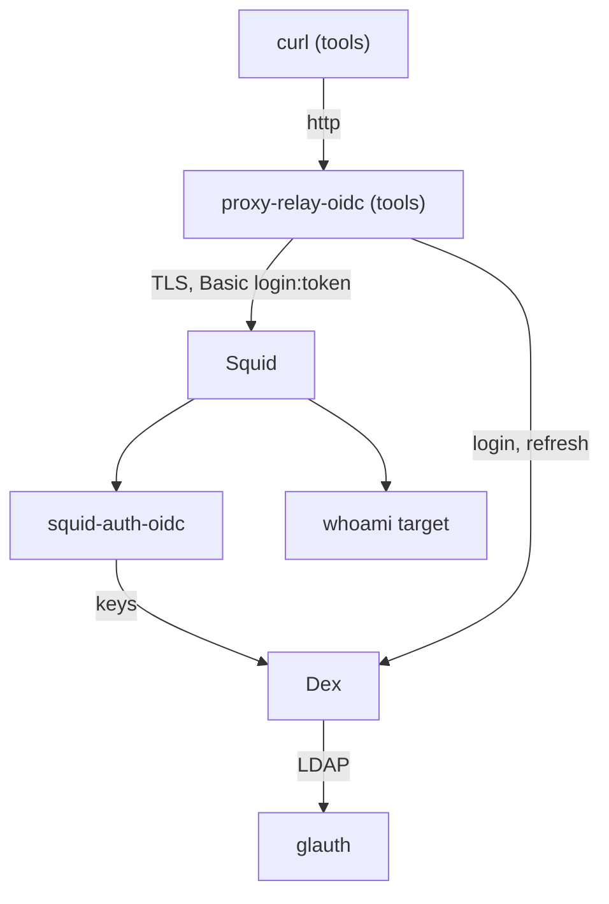

# squid-auth-oidc-lab

An end-to-end lab for [squid-auth-oidc](https://github.com/zinrai/squid-auth-oidc)
and [proxy-relay-oidc](https://github.com/zinrai/proxy-relay-oidc): Squid
checks OIDC ID tokens from Dex, and the relay logs in and sends them. It runs
both tools with the configuration in their READMEs, against Squid, Dex and
glauth in Docker. It is a lab, not a deployment.



## Requirements

- Docker with Compose
- Python 3

## Set up

Compose runs third-party images only. The tools' binaries and the
certificates are put in `bin/` and `certs/` by hand, and mounted from there.

Put these binaries in `bin/` under these names, executable:

- `squid-auth-oidc` and `proxy-relay-oidc`, from the releases of
  [squid-auth-oidc](https://github.com/zinrai/squid-auth-oidc/releases) and
  [proxy-relay-oidc](https://github.com/zinrai/proxy-relay-oidc/releases).
  They run in the containers, so take the Linux build for the Docker host's
  architecture.
- `ephemeral-ca`, from [its releases](https://github.com/zinrai/ephemeral-ca/releases).
  It runs here, so take the build for this machine.

To check a change before it is released, build that tool into `bin/`
instead, statically as the releases are (the tools container has no glibc),
for example from a squid-auth-oidc clone:

```
CGO_ENABLED=0 GOOS=linux go build -o ../squid-auth-oidc-lab/bin/squid-auth-oidc .
```

Issue the certificates: a CA, and server certificates for Dex and Squid.
They are readable by all, because Squid and Dex run as their own users in
the containers:

```
bin/ephemeral-ca -out certs -server dex.example.com
bin/ephemeral-ca -out certs -server squid.example.com
chmod -R a+rX certs
```

The certificates are valid for 24 hours. Run the two `ephemeral-ca` lines
again to renew them; the CA is reused.

## Run

```
docker compose up -d
python3 e2e/e2e.py
```

e2e.py takes about five minutes, prints one line per check and exits
non-zero when one fails. The lab keeps running afterwards for a look around:

```
docker compose logs squid
docker compose exec squid cat /var/log/squid/access.log
```

Remove it:

```
docker compose down
rm -rf certs
```

## What it checks

- The helper, with tokens minted at Dex: groups decide the destinations; a
  token under another login, with edited groups, or for another audience is
  refused; a token without groups after one with them does not keep the old
  groups; a token with 150 groups is over Squid's 8,192-byte helper line;
  `access.log` names the user and the groups.
- The relay, started with its README's run command: `502` naming the login
  URL until the login, the login through Dex's form, plain HTTP and
  `CONNECT`, the client's own proxy credentials replaced, a plain-HTTP
  upgrade refused, and still passing past the two-minute token lifetime.
  Logged in with 150 groups, it refuses to send the token.
- A certificate reload: Squid's certificate is reissued and
  `squid -k reconfigure` serves it without a restart.

## How the lab is put together

The containers carry the host names the tools' READMEs use, as Docker
network aliases: `dex.example.com`, `squid.example.com`,
`app.internal.example.com` (inside the README's `.internal.example.com`) and
`public.example.com` (outside it). glauth has the README's `admins` group.
`squid/squid.conf` is the squid-auth-oidc README's configuration block, and
e2e.py runs the relay with its README's command; both are copies, carried
over by hand when a README changes. example.com is reserved for
documentation and never names a real host.

Squid is `ubuntu/squid` (Squid 7.7, built with GnuTLS). The tools container
is `curlimages/curl` with the relay mounted in; the lab CA stands in for a
public one through `SSL_CERT_FILE` for the relay and the helper,
`CURL_CA_BUNDLE` for curl, and `--proxy-cacert` when curl uses Squid as an
HTTPS proxy. The target is `traefik/whoami` on plain HTTP: Squid does not
look inside a `CONNECT` tunnel, and the target only has to answer.

Dex issues ID tokens for two minutes and allows the password grant, so
e2e.py can mint tokens without a browser; the relay uses the authorization
code flow.

| User | Password | Groups |
|------|----------|--------|
| alice | password | admins, staff |
| bob | password | staff |
| heavy100 | password | 100 GUID-named groups |
| heavy150 | password | 150 GUID-named groups |

## License

This project is licensed under the [MIT License](LICENSE).
